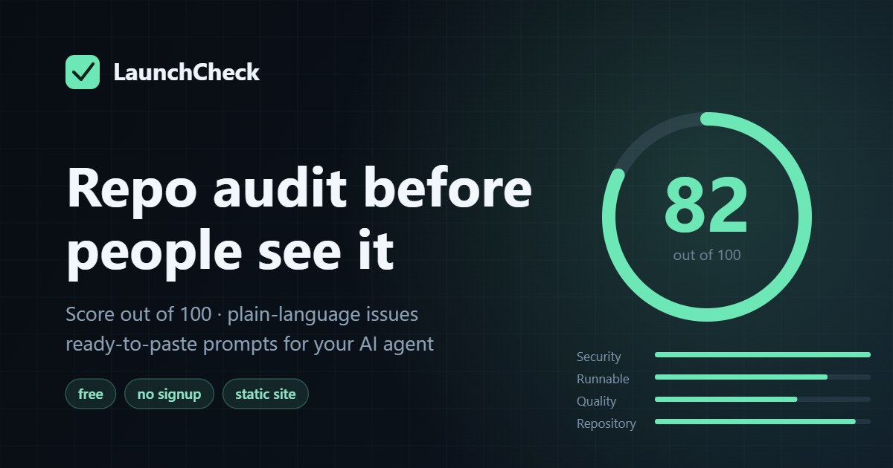

# LaunchCheck

**Paste a GitHub repo link. Get a score out of 100, a plain-language list of what is broken, and ready-to-paste prompts for your AI agent.**

No signup. No install. No backend. No analytics.

[**Try it →**](https://tizz13.github.io/launchcheck/) · [Русская версия](#русский)



---

## The problem

You built something with an AI agent. It works on your machine. You publish it — and nothing happens.

Usually it is not because the project is bad. It is because a stranger opens the repo and cannot answer three questions in ten seconds:

1. What is this and who is it for?
2. How do I run it?
3. Why should I trust it?

LaunchCheck answers those questions before anyone else has to. It reads the public repository, runs 23 fixed checks and shows exactly what is missing — in the order that matters.


## What you get

- **A score out of 100** across six categories, with a color-coded breakdown.
- **A list of issues in plain language** — what is wrong, why it costs you users, and how bad it is.
- **A ready-to-paste prompt for every issue**, written for Claude Code, Codex, Cursor or any other agent. Copy one, or copy all and let the agent work through the list.
- **A shareable card (1200×630 PNG)** for social media and a **static SVG badge** for your README.

## How it works

LaunchCheck is a static page. There is no server, no database and no AI model:

1. The browser calls the public GitHub API a few times: repository metadata, file tree, README, releases.
2. A deterministic rule engine runs 23 checks. Same repository → same score, today or in a year.
3. Results are rendered locally. Nothing is sent anywhere except `api.github.com`.

That is why it is free and why it can stay free: it is three files on GitHub Pages.

## Scoring

| Category | Points | What is checked |
| --- | --- | --- |
| **Security** | 25 | Committed `.env` files (8), private keys (7), secrets in configs (10) |
| **Runnable** | 20 | Install/run instructions in README (6), project manifest (4), lockfile (3), entry point (4), CI (3) |
| **Quality** | 15 | Tests (6), linter/formatter config (4), tests actually running in CI (3), files over 10 MB (2) |
| **Repository** | 15 | License (5), description + topics + long README + image (8), English README (2) |
| **Product** | 15 | Demo link (5), releases (3), changelog (2), issue templates + docs folder (4), screenshot (1) |
| **Trust** | 10 | Checksums or security policy (4), CONTRIBUTING/CODE_OF_CONDUCT (3), contact info (3) |

Grades: **85+** ready to ship · **70–84** almost there · **50–69** too early to show · **below 50** fix it first.

The score is not a verdict on your code quality. It measures one thing: how ready the repository is to be seen by strangers.

## What it is not

- **Not an AI product.** There is no model, no prompt, no key to leak. The prompts are generated from templates, filled with what the checks found.
- **Not a security audit.** It catches the obvious mistakes — a committed `.env`, a private key, a hardcoded token — and tells you to rotate the keys. It does not replace a real audit.
- **Not a code review.** It looks at the repository as a package: files, configs, docs, releases.
- **Not a gatekeeper.** A low score does not mean the project is bad. Plenty of great tools score badly because nobody wrote the boring parts.

## Privacy

- There is no backend and no analytics.
- The only network requests go to `api.github.com`.
- A GitHub token is optional, stays in your browser's `localStorage` and is sent only to `api.github.com`. It is needed for private repositories and for the 5000 req/hour limit instead of 60.
- Detected secret values are never rendered, logged or sent anywhere. The report only says which file looked suspicious and what kind of secret it resembles.

## Rate limits

Anonymous GitHub API allows 60 requests per hour, which is roughly 6–10 audits. Add a [personal access token](https://github.com/settings/tokens) in settings (scope `public_repo` is enough) to get 5000 requests per hour. The remaining quota is shown in the header.

## Run it locally

No build step, no dependencies:

```bash
git clone https://github.com/TIZZ13/launchcheck.git
cd launchcheck
python -m http.server 8765
# open http://127.0.0.1:8765
```

Any static server works. Opening `index.html` directly is not recommended: `fetch` to the GitHub API may be blocked by the `file://` origin.

Run the tests (Node 20+, no dependencies):

```bash
node --test tests/
```

The suite covers URL parsing and the secret scanner — the two places where a silent bug would produce a wrong score. CI runs the same tests, a syntax check and a check that every local asset exists.

## Roadmap

- [ ] History: keep the last score per repo and show the difference
- [ ] `launchcheck.config.json` to disable checks that do not apply
- [ ] More stacks and monorepo awareness
- [ ] Ready-made PR that fixes the easy findings (license, issue templates, `.gitignore`)
- [ ] Optional dynamic badge endpoint

## Contributing

Issues and pull requests are welcome. The most useful contributions are **new checks with a clear rule and a clear prompt**: if you can describe a mistake a maintainer should fix before launch, it probably belongs here.

Please keep the project dependency-free. Any change must work as plain HTML/CSS/JS on GitHub Pages.

## License

[MIT](LICENSE)

---

## Русский

**Вставь ссылку на GitHub-репозиторий — получи оценку из 100, понятный список проблем и готовые промпты для своего ИИ-агента.**

Без регистрации, без установки, без бэкенда, без аналитики. [Открыть сайт →](https://tizz13.github.io/launchcheck/)

Полное описание на русском: [README.ru.md](README.ru.md).
