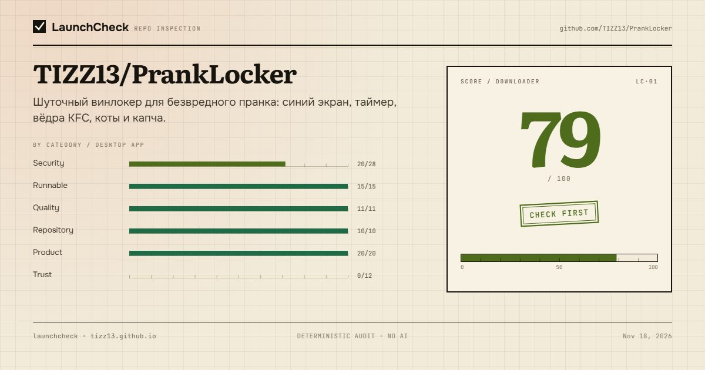
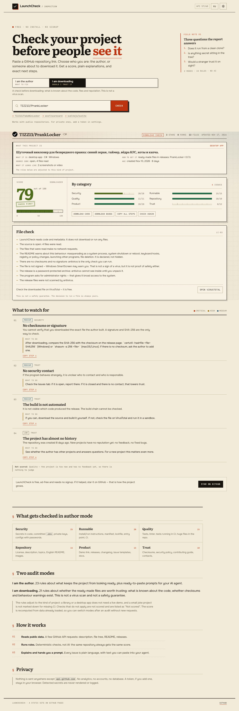

# LaunchCheck

**Paste a GitHub repo link. Get a score out of 100, a plain-language list of what is broken, and ready-to-paste prompts for your AI agent.**

Two audit modes: **author** (fix your own project) and **downloader** (decide whether a project is worth downloading). The mode can be switched after an audit — the score is recomputed from data already loaded, with no new requests.

No signup. No install. No backend. No analytics.

[**Try it →**](https://tizz13.github.io/launchcheck/) · [Русская версия](#русский)


---

## The problem

You built something with an AI agent. It works on your machine. You publish it — and nothing happens.

Usually it is not because the project is bad. It is because a stranger opens the repo and cannot answer three questions in ten seconds:

1. What is this and who is it for?
2. How do I run it?
3. Why should I trust it?

LaunchCheck answers those questions before anyone else has to. It reads the public repository, runs 23 fixed checks and shows exactly what is missing — in the order that matters.

The same page works from the other side too. If you are about to download a stranger's program, the **downloader** mode runs 21 different checks: is the source open, does the code do something risky that the README never mentions, are there checksums, are the side effects and the way back documented. It never says a file is safe or virus-free — it lists what is known and what is not.



## What you get



- **A score out of 100** across six categories, with a color-coded breakdown.
- **A project profile first** — what this is (desktop app, web app, CLI, library, game, bot, docs), on which platform, how it is distributed, and which rules therefore do not apply.
- **A list of issues in plain language** — what is wrong, why it costs you users, and how bad it is. Each one has a concrete action, not just a complaint.
- **A ready-to-paste prompt for every issue** in author mode, written for Claude Code, Codex, Cursor or any other agent. Copy one, or copy all and let the agent work through the list.
- **A file safety brief** in downloader mode: which source files were read, what the code actually does, which of it the README declares, and whether checksums exist. Facts, not a verdict.
- **A shareable card (1200×630 PNG)** for social media and a **static SVG badge** for your README.

## How it works

LaunchCheck is a static page. There is no server, no database and no AI model:

1. The browser calls the public GitHub API a few times: repository metadata, file tree, README, releases, and a few small source files for the risk scan.
2. A deterministic rule engine runs one of two fixed profiles — 23 checks for authors, 21 for downloaders. Same repository → same score, today or in a year, in Russian or English.
3. Results are rendered locally. Nothing is sent anywhere except `api.github.com`.

Checks that do not apply are not scored at all and are listed under "Not scored": a library needs no live demo, a desktop app can satisfy the demo rule with a screenshot, `requirements.txt` is not punished for having no lockfile, and a small new or joke project gets halved weights for CI, tests, linter and contributor rules with wording that says why.

That is why it is free and why it can stay free: it is three files on GitHub Pages.

## Scoring

### Author mode — 23 checks, 100 points

| Category | Points | What is checked |
| --- | --- | --- |
| **Security** | 25 | Committed `.env` files (7), private keys (5), secrets in configs (8), risky calls the README never mentions (5) |
| **Runnable** | 20 | Install/run instructions in README (6), project manifest (4), lockfile (3), entry point (4), CI (3) |
| **Quality** | 15 | Tests (6), linter/formatter config (4), tests actually running in CI (3), files over 10 MB (2) |
| **Repository** | 15 | License (5), description + topics + long README + image (8), English README (2) |
| **Product** | 15 | Demo or screenshot (6), releases (3), changelog (2), issue templates + docs folder (4) |
| **Trust** | 10 | Checksums or security policy (4), CONTRIBUTING/CODE_OF_CONDUCT (3), contact info (3) |

Grades: **85+** ready to ship · **70–84** almost there · **50–69** too early to show · **below 50** fix it first.

### Downloader mode — 21 checks, 100 points

| Category | Points | What is checked |
| --- | --- | --- |
| **Security** | 28 | Source is open (8), undeclared dangerous calls (8 + 4), checksums or signature (8) |
| **Runnable** | 15 | Install/download instructions (5), something to download (5), system requirements (5) |
| **Quality** | 15 | Screenshots or video (6), a place for feedback (4), still maintained (5) |
| **Repository** | 10 | License (4), clear description (4), other users (2) |
| **Product** | 20 | Claims match the README (6), features described (4), release notes (3), file for your system (3), warnings about side effects (4) |
| **Trust** | 12 | Security contact (4), automated build (4), project history (4) |

Grades: **85+** try with care · **70–84** check first · **50–69** many questions · **below 50** better not run.

The score is not a verdict on your code quality. In author mode it measures how ready the repository is to be seen by strangers; in downloader mode it measures how many questions are still open before running someone else's files. The exact rule behind every check is documented in [docs/checks.md](docs/checks.md).

## What it is not

- **Not an AI product.** There is no model, no prompt, no key to leak. The prompts are generated from templates, filled with what the checks found.
- **Not a security audit.** It catches the obvious mistakes — a committed `.env`, a private key, a hardcoded token — and tells you to rotate the keys. It does not replace a real audit.
- **Not a virus scan.** Downloader mode reads the source, the README and the release metadata, and reports signals. It never downloads or runs a release file, never hashes it and never claims that anything is safe. For that, use VirusTotal or a sandbox — the report links to both.
- **Not a code review.** It looks at the repository as a package: files, configs, docs, releases.
- **Not a gatekeeper.** A low score does not mean the project is bad. Plenty of great tools score badly because nobody wrote the boring parts.

## Privacy

- There is no backend and no analytics.
- The only network requests go to `api.github.com`.
- A GitHub token is optional, stays in your browser's `localStorage` and is sent only to `api.github.com`. It is needed for private repositories and for the 5000 req/hour limit instead of 60.
- Detected secret values are never rendered, logged or sent anywhere. The report only says which file looked suspicious and what kind of secret it resembles.

## Rate limits

Anonymous GitHub API allows 60 requests per hour, which is roughly 6–10 audits. Add a [personal access token](https://github.com/settings/tokens) in settings (scope `public_repo` is enough) to get 5000 requests per hour. The remaining quota is shown in the header.

## Run it locally

No build step, no dependencies:

```bash
git clone https://github.com/TIZZ13/launchcheck.git
cd launchcheck
python -m http.server 8765
# open http://127.0.0.1:8765
```

Any static server works. Opening `index.html` directly is not recommended: `fetch` to the GitHub API may be blocked by the `file://` origin.

Run the tests (Node 20+, no dependencies):

```bash
node --test tests/
```

The suite covers URL parsing, the secret scanner, README language detection, the risk scan, project-profile detection and score normalisation — the places where a silent bug would produce a wrong score. `scripts/check.py` verifies that every local asset referenced by `index.html` exists and that the social preview image stays small; run it with `python3 scripts/check.py`.

## Roadmap

- [ ] History: keep the last score per repo and show the difference
- [ ] `launchcheck.config.json` to disable checks that do not apply
- [ ] More stacks and monorepo awareness
- [ ] Ready-made PR that fixes the easy findings (license, issue templates, `.gitignore`)
- [ ] Optional dynamic badge endpoint

## Contributing

Issues and pull requests are welcome. The most useful contributions are **new checks with a clear rule and a clear prompt**: if you can describe a mistake a maintainer should fix before launch, it probably belongs here.

Read [CONTRIBUTING.md](CONTRIBUTING.md) and the [full list of checks](docs/checks.md) first.

Please keep the project dependency-free. Any change must work as plain HTML/CSS/JS on GitHub Pages.

## License

[MIT](LICENSE)

Typefaces: Literata, Onest and JetBrains Mono — self-hosted from `assets/fonts/`, licensed under the SIL Open Font License 1.1 (see [assets/fonts/OFL.txt](assets/fonts/OFL.txt)).

---

## Русский

**Вставь ссылку на GitHub-репозиторий — получи оценку из 100, понятный список проблем и готовые промпты для своего ИИ-агента.**

Два режима: **автор** (починить свой проект) и **скачиваю** (решить, стоит ли доверять чужим файлам). Режим переключается после проверки — балл пересчитывается из уже загруженных данных, без новых запросов.

Без регистрации, без установки, без бэкенда, без аналитики. [Открыть сайт →](https://tizz13.github.io/launchcheck/)

Полное описание на русском: [README.ru.md](README.ru.md).
