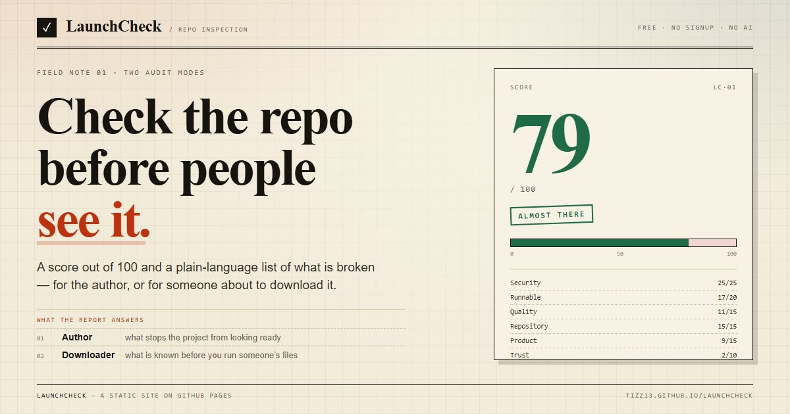
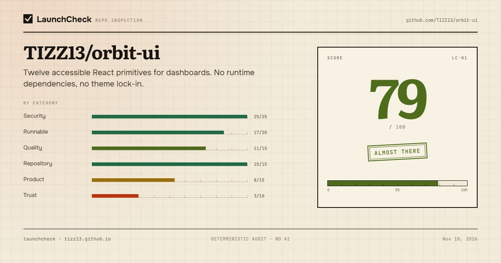
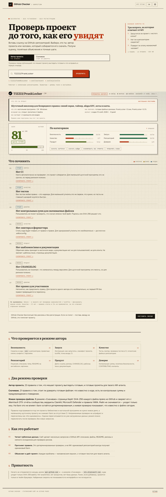

# GitHub Checker

**Вставь ссылку на GitHub-репозиторий — получи оценку из 100, понятный список проблем и готовые промпты для своего ИИ-агента.**

Два режима проверки: **автор** (починить свой проект) и **скачиваю** (решить, стоит ли доверять чужим файлам). Режим переключается после проверки: балл пересчитывается из уже загруженных данных, без новых запросов.

В режиме «Скачиваю» страница проверяет и сами файлы релиза: берёт SHA-256 каждого файла из GitHub и сверяет его с публичными базами угроз. Сам файл при этом не скачивается.

Без регистрации, без установки, без бэкенда, без аналитики.

[**Открыть сайт →**](https://tizz13.github.io/GitHubChecker/) · [English](README.md)



---

## Зачем

Ты собрал проект с ИИ-агентом. У тебя он работает. Ты его опубликовал — и тишина.

Обычно дело не в коде. Человек открывает репозиторий и за десять секунд не может ответить на три вопроса:

1. Что это и для кого?
2. Как это запустить?
3. Почему этому можно доверять?

GitHub Checker отвечает на них до того, как их задаст первый посетитель. Он читает публичные данные репозитория, прогоняет 23 фиксированные проверки и показывает, что именно не хватает — в порядке важности.

С той же страницы можно смотреть и с другой стороны. Если ты собираешься скачать чужую программу, режим **«Скачиваю»** прогоняет 21 другую проверку: открыт ли исходный код, делает ли код что-то рискованное, о чём README молчит, есть ли контрольные суммы, описаны ли побочные эффекты и путь назад. Потом он сверяет файлы релиза по хешу и показывает, что о них говорят публичные движки и отчёты сообщества. Он никогда не говорит, что файл безопасен или без вирусов: он показывает, что известно, а что нет.



## Что ты получаешь



- **Оценку из 100** по шести категориям с разбивкой по баллам.
- **Карточку проекта в начале** — что это (настольная программа, сайт, CLI, библиотека, игра, бот, документация), под какую систему, как распространяется и какие правила поэтому не применяются.
- **Список проблем человеческим языком** — что не так, почему это стоит пользователей и насколько это критично. У каждой проблемы есть конкретное действие, а не просто жалоба.
- **Готовый промпт для каждой проблемы** в режиме автора — для Claude Code, Codex, Cursor или другого агента. Можно скопировать один или все сразу.
- **Справку о файлах** в режиме «Скачиваю»: сколько исходников прочитано, что код делает на самом деле, что из этого объявлено в README и есть ли контрольные суммы. Факты, а не вердикт.
- **Живую проверку по хешу** в режиме «Скачиваю»: SHA-256 каждого файла релиза (его считает GitHub) сверяется с AlienVault OTX и показывается с вердиктами ClamAV, Microsoft Defender и правил YARA, плюс ссылки на полный отчёт и на VirusTotal. «Нет данных» значит «неизвестно», а не «чисто».
- **Карточку 1200×630 в PNG** для соцсетей и **статический SVG-бейдж** для README.

## Как это работает

Это статическая страница. Нет сервера, нет базы данных и нет ИИ-модели:

1. Браузер делает несколько запросов к публичному GitHub API: данные репозитория, дерево файлов, README, релизы и несколько небольших файлов с кодом для сканера рисков.
2. Детерминированный движок прогоняет один из двух фиксированных наборов правил: 23 проверки для автора, 21 для скачивающего. Одинаковый репозиторий всегда получает одинаковый балл — сегодня и через год, на русском и на английском.
3. В режиме «Скачиваю» страница ещё читает SHA-256, который GitHub публикует для каждого файла релиза, и сверяет хеш с AlienVault OTX — публичной базой киберразведки. Наружу уходит только хеш, сам файл не скачивается.
4. Результат рисуется локально. Наружу уходят только запросы к `api.github.com` и — в режиме «Скачиваю» — к `otx.alienvault.com`.

Неприменимые проверки не оцениваются вообще и перечислены как «Не оценивалось»: библиотеке не нужно живое демо, настольной программе демо заменяет скриншот, `requirements.txt` не штрафуется за отсутствие lockfile, а маленький новый или шуточный проект получает половинный вес за CI, тесты, линтер и правила для участников — с текстом, который объясняет почему.

Поэтому это бесплатно и может оставаться бесплатным: три файла на GitHub Pages.

## Что проверяется

### Режим автора — 23 проверки, 100 баллов

| Категория | Баллы | Что смотрим |
| --- | --- | --- |
| **Безопасность** | 25 | `.env` в репозитории (7), приватные ключи (5), секреты в конфигах (8), рискованные вызовы без упоминания в README (5) |
| **Запуск** | 20 | Инструкция «как запустить» в README (6), манифест проекта (4), lockfile (3), точка входа (4), CI (3) |
| **Качество** | 15 | Тесты (6), линтер и форматтер (4), тесты в CI (3), файлы больше 10 МБ (2) |
| **Репозиторий** | 15 | Лицензия (5), описание + темы + длинный README + картинка (8), английский README (2) |
| **Продукт** | 15 | Демо или скриншот (6), релизы (3), CHANGELOG (2), шаблоны issue и папка docs (4) |
| **Доверие** | 10 | Контрольные суммы или SECURITY.md (4), CONTRIBUTING или CODE_OF_CONDUCT (3), контакты (3) |

Оценки: **85+** готово к запуску · **70–84** почти готово · **50–69** рано показывать · **ниже 50** сначала починить.

### Режим «Скачиваю» — 21 проверка, 100 баллов

| Категория | Баллы | Что смотрим |
| --- | --- | --- |
| **Безопасность** | 28 | Исходный код открыт (8), рискованные вызовы без предупреждения (8 + 4), контрольные суммы или подпись (8) |
| **Запуск** | 15 | Инструкция по установке или скачиванию (5), что скачать (5), требования к системе (5) |
| **Качество** | 15 | Скриншоты или видео (6), место для отзывов (4), проект ещё поддерживается (5) |
| **Репозиторий** | 10 | Лицензия (4), понятное описание (4), другие пользователи (2) |
| **Продукт** | 20 | Обещания совпадают с README (6), описанные возможности (4), описание релиза (3), файл под твою систему (3), предупреждения о побочных эффектах (4) |
| **Доверие** | 12 | Контакт по безопасности (4), автоматическая сборка (4), история проекта (4) |

Оценки: **85+** можно пробовать осторожно · **70–84** сначала проверь · **50–69** много вопросов · **ниже 50** лучше не запускать.

Балл — это не вердикт качеству кода. В режиме автора он измеряет, насколько репозиторий готов к тому, что его увидят чужие люди; в режиме «Скачиваю» — сколько вопросов остаётся до запуска чужих файлов. Точное правило каждой проверки описано в [docs/checks.md](docs/checks.md).

## Чем это не является

- **Это не ИИ-продукт.** Нет модели, нет промптов внутри модели, нет ключа, который можно утечь. Тексты промптов собираются из шаблонов и данных проверок.
- **Это не аудит безопасности.** Он ловит очевидное — закоммиченный `.env`, приватный ключ, токен в конфиге — и говорит перевыпустить ключи. Он не заменяет настоящий аудит.
- **Это не гарантия.** Режим «Скачиваю» читает исходники, README и данные релиза, а потом сверяет хеши файлов с публичными базами. Он не скачивает и не запускает файлы и никогда не говорит, что что-то безопасно. Хеш, которого нет в базах, значит «неизвестно», а не «чисто». За вердиктом иди по ссылке на VirusTotal или песочницу из отчёта.
- **Это не ревью кода.** Он смотрит на репозиторий как на упаковку: файлы, конфиги, документация, релизы.
- **Это не судья.** Низкий балл не значит, что проект плохой. Многие полезные штуки получают мало баллов просто потому, что никто не написал скучную часть.

## Приватность

- Бэкенда и аналитики нет.
- Сетевые запросы идут только на `api.github.com` и — в режиме «Скачиваю» — на `otx.alienvault.com` (туда уходит хеш файла и больше ничего).
- GitHub-токен необязателен, хранится в `localStorage` браузера и отправляется только на `api.github.com`. Он нужен для приватных репозиториев и для лимита 5000 запросов в час вместо 60.
- Найденные значения секретов никогда не показываются в интерфейсе и не логируются. В отчёте есть только имя файла и тип секрета.

## Лимиты

Анонимно GitHub API даёт 60 запросов в час — это примерно 6–10 проверок. Токен (scope `public_repo`) поднимает лимит до 5000 запросов в час. Остаток видно в шапке сайта.

## Локальный запуск

Сборки и зависимостей нет:

```bash
git clone https://github.com/TIZZ13/GitHubChecker.git
cd GitHubChecker
python -m http.server 8765
# открыть http://127.0.0.1:8765
```

Подойдёт любой статический сервер. Открывать `index.html` напрямую не стоит: браузер может заблокировать запросы к GitHub API с `file://`.

Тесты (Node 20+, без зависимостей):

```bash
node --test
```

Тесты покрывают разбор ссылок, поиск секретов, определение языка README, сканер рисков, определение типа проекта, нормализацию балла и живую проверку по хешу (разбор digest, выбор файлов, вердикты OTX) — места, где незаметная ошибка даёт неправильный ответ. `scripts/check.py` проверяет, что все локальные файлы из `index.html` существуют, и следит за размером картинки для соцсетей.

## Планы

- [ ] История: хранить последний балл репозитория и показывать разницу
- [ ] `githubchecker.config.json`, чтобы отключать неприменимые проверки
- [ ] Больше стеков и поддержка монорепозиториев
- [ ] Готовый PR, который чинит простые находки (лицензия, шаблоны issue, `.gitignore`)
- [ ] Динамический бейдж

## Участие

Issues и pull requests приветствуются. Самое полезное — **новые проверки с понятным правилом и понятным промптом**: если ты можешь описать ошибку, которую стоит исправить до запуска, ей, скорее всего, здесь место.

Проект остаётся без зависимостей: любые изменения должны работать как обычные HTML/CSS/JS на GitHub Pages.

## Лицензия

[MIT](LICENSE)

Шрифты: Literata, Onest и JetBrains Mono — лежат локально в `assets/fonts/`, лицензия SIL Open Font License 1.1 (см. [assets/fonts/OFL.txt](assets/fonts/OFL.txt)).
